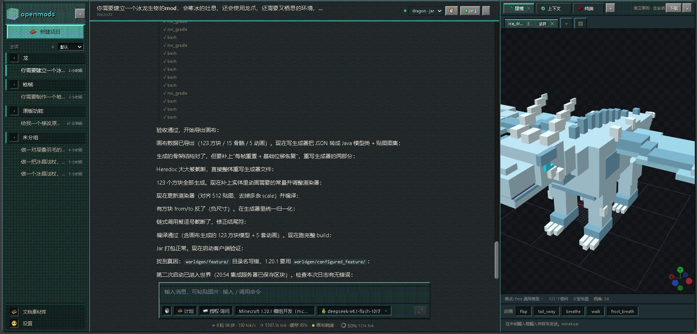
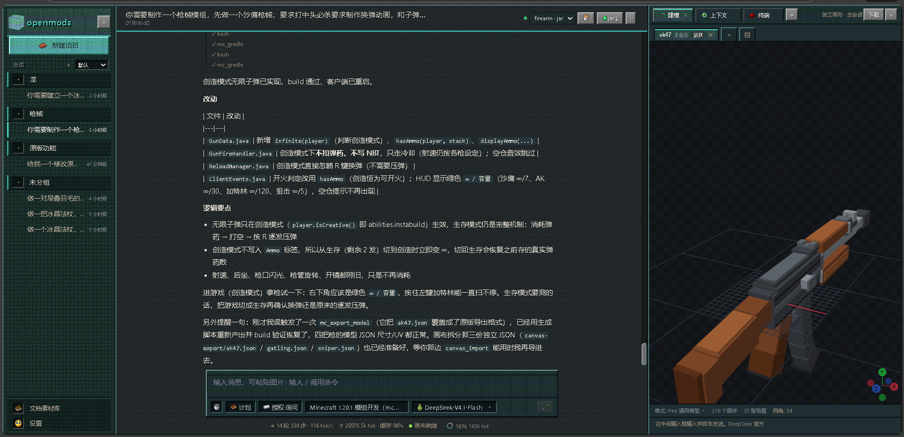
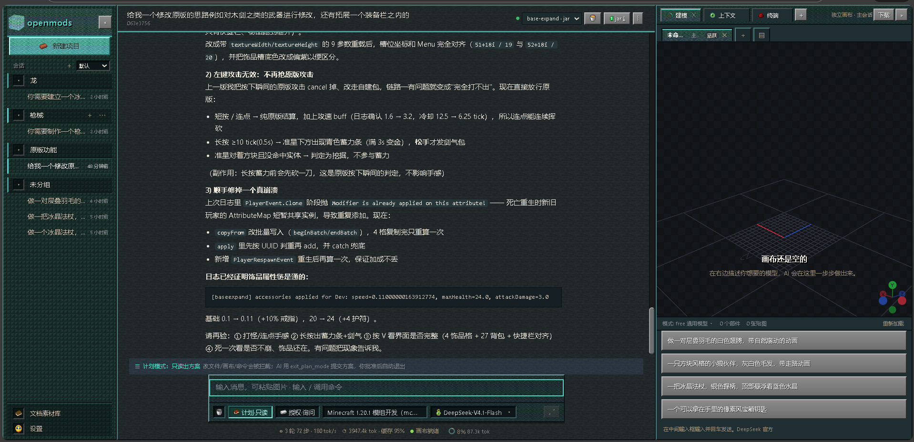
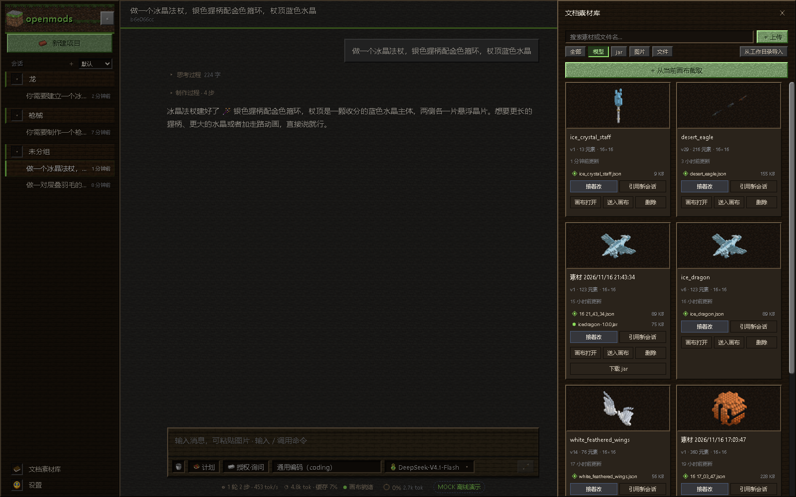
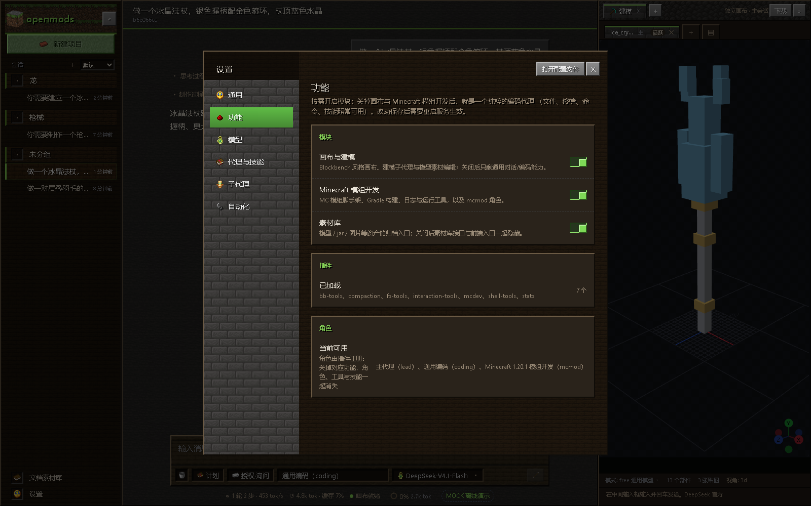
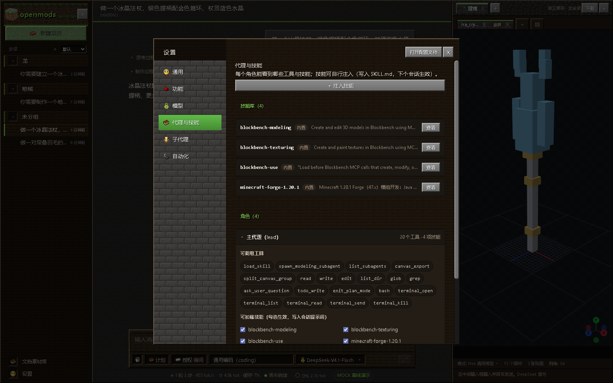

<div align="center">


# openmods

**本地 AI 工作台 —— Minecraft 像素界面 · 多画布建模 · MC 模组开发闭环**

<sub>Fastify + React + Vite 全栈 TypeScript · 画布基于 Blockbench 5.2.2（GPL-3.0）</sub>

<br>

[](https://www.minecraft.net/)
[](https://files.minecraftforge.net/)
[](https://www.typescriptlang.org/)
[](https://nodejs.org/)
[](LICENSE)

</div>

| <a href="#-快速开始"><br>快速开始</a> | <a href="#-功能一览"><br>功能一览</a> | <a href="#-界面预览"><br>界面预览</a> | <a href="#-离线构建包vendor重要"><br>离线构建包</a> | <a href="#开发与实现文档"><br>开发文档</a> |
|:---:|:---:|:---:|:---:|:---:|

---

**openmods 是跑在本机的 AI 工作台**：三栏主界面 + **并发建模子代理（各自独立画布）** + **无头 Blockbench 画布** + **MC 1.20.1 模组开发闭环**（建模 → 导出 → 构建 → 一键进游戏测试 → jar 导出），外加可插拔工具/插件、多文件素材库、省 token 压缩与用量看板。

界面是完整的 **Minecraft 像素皮肤**：原版方块贴图铺底、物品图标做功能入口；提供草方块 / 樱花 / 深海 / 下界 / 末地 5 套主题，结构墙随主题换材质，左上角品牌方块固定为草方块。

> [!NOTE]
> **路线图**：openmods 现在以独立本地工作台的形式提供。项目足够成熟之后，会考虑把它做成 **deepseek-harness（dsh）的插件**，复用 dsh 的代理运行时与插件机制，不再单独维护一套外壳。

##  功能一览

| 功能 | 说明 |
|---|---|
|  **MC 像素界面** | 5 套方块主题（草方块 / 樱花 / 深海 / 下界 / 末地）；结构墙随主题换材质，品牌方块固定草方块；物品图标、像素斜面、主题色主操作 |
|  **多画布建模** | 主会话与每个建模子代理各有一块独立画布；右侧多页签查看/切换，活跃画布 durable，支持新建空白画布 |
|  **素材库** | 模型 / Jar 构建 / 图片 / 文件四类分开；上传、拖拽、工作目录导入、从画布截取；Jar 页多选后统一启动独立 Forge 测试客户端 |
|  **主代理全能力** | 权限审批、计划模式、询问用户、终端、文件读写、并发子代理——对标 dsh 主 agent |
|  **首次环境检测** | 首次打开检测 JDK 17 / Gradle 离线缓存 / Git；向导选择 JDK 与缓存路径，设置 → 环境可随时重检、整理错位 vendor |
|  **角色协作** | MC 工程目录默认 mcmod；lead 出创意与方案、mcmod 负责实施，移交后自动续跑；mcmod 的造型需求先派建模子代理 |
|  **MC 开发闭环** | `mc_scaffold` 建工程 → 建模子代理出模型并在独立画布导出 JSON → `mc_gradle build` → 标题栏「▶ 测试 Mod」→「jar ⤓」导出（Forge 1.20.1 / 国内镜像 / 离线构建包） |
|  **代理与技能** | 三个角色（lead / mcmod / modeling）的工具与技能分配可视化；技能自注入、内置技能只读 |
|  **上下文面板** | 底部状态条与右侧面板跟随当前画布页的 owner 会话；分段占用、工具用量、耗时分布、token 环形图、每轮明细 |
|  **图片输入** | Ctrl+V 粘贴直发视觉模型；纯文本模型按 dsh 语义诚实降级 |
|  **输入框自适应** | 随内容自动长高（36–196px），超过后内部滚动；发送后自动缩回单行 |
|  **省 token** | 阈值触发八段式检查点摘要 + 工具结果免费裁剪，按模型覆盖阈值 |
|  **可裁剪功能** | 画布与建模 / Minecraft 模组开发 / 素材库可在设置里独立关闭 |

##  界面预览

| 龙模型：建模 → 构建 → 进游戏 | 枪械模型：无子弹射击 + 换弹 |
|---|---|
|  |  |
| **原版扩展开局**：多画布 + 上下文建议 | **素材库**：模型卡片 + 等距 3D 缩略图 |
|  |  |
| **设置 → 功能**：三大功能开关 | **设置 → 代理与技能**：工具与技能分配 |
|  |  |

> [!NOTE]
> 截图来自本地实机会话（龙 / 枪械 / 原版扩展）与设置页；`MOCK=1` 可离线复现画布与设置流程。

##  快速开始

```powershell
git clone https://github.com/rover0927/openmods.git
cd openmods
npm install
npm run build:bbcanvas   # 从 ../blockbench 构建无头画布（仓库已带产物，跳过亦可）

# 必做：下载离线构建包（约 224MB，Gradle 8.8 + ForgeGradle 缓存）
# 不下载的话，首次构建/运行 Minecraft 客户端会临时联网补齐依赖，慢且受镜像影响
# 注意：PowerShell 里 curl 是 Invoke-WebRequest 的别名，必须写 curl.exe
curl.exe -L -o openmods-vendor.zip https://github.com/rover0927/openmods/releases/latest/download/openmods-vendor.zip
New-Item -ItemType Directory -Force plugins/mcdev/vendor | Out-Null
tar -xf openmods-vendor.zip -C plugins/mcdev/vendor
# 解压后顶层应直接是 gradle-8.8/ 与 fg-maven/，不要再套一层 openmods-vendor/

# 可选：测试客户端离线包（约 141MB），免去「测试 Mod」时联网安装
curl.exe -L -o openmods-test-client.zip https://github.com/rover0927/openmods/releases/latest/download/openmods-test-client.zip
New-Item -ItemType Directory -Force data/mc-test-client | Out-Null
tar -xf openmods-test-client.zip -C data/mc-test-client
# 解压后顶层应直接是 .minecraft/

Copy-Item .env.example .env   # 按需修改；默认 MOCK=0（真实 LLM）
npm start                     # 生产：自动构建前端 → 单进程 http://127.0.0.1:8787
# npm run dev                 # 调试：tsx watch + vite 热更新（:8787 + :5173）
```

> Git Bash / macOS / Linux 下把 `curl.exe` 换成 `curl`、`New-Item -ItemType Directory -Force` 换成 `mkdir -p`、`Copy-Item` 换成 `cp` 即可。

> [!IMPORTANT]
> **构建包是必做步骤**：`openmods-vendor.zip` 必须解压到 `plugins/mcdev/vendor/`（得到 `plugins/mcdev/vendor/gradle-8.8/` 与 `plugins/mcdev/vendor/fg-maven/`）。也可以在启动后到 设置 → 环境 的 Gradle 卡片点「GitHub 官方 / Release API」一键下载，效果相同。

访问 `http://127.0.0.1:8787`：

首次打开会先弹出 **环境检测**：JDK 17 / Gradle 缓存 / Git / 测试客户端。已下载 vendor 时缓存会显示「就绪」；也可以「稍后配置」，随时在 设置 → 环境 修改。

1. 左栏顶部「**新建项目**」建一个项目（可关联电脑上的文件夹）；
2. 在「**会话**」分区头部点 `＋`（或在项目行点 `＋`）新建会话；
3. 在中央输入框或右侧建议 chip 发消息，建模任务会自动派给子代理。

> [!TIP]
> **成就达成：打开工作台** —— 浏览器访问 `http://127.0.0.1:8787`，左栏新建项目即可开始；在 `.env` 里设 `MOCK=1` 可离线跑通演示流程。

**模式**：

- `MOCK=0`（默认）：真实 LLM——模型来自设置系统（供应商 + key），按请求解析
- `MOCK=1`：离线演示——脚本化假 LLM（冰晶法杖流程），无需任何 key

> [!TIP]
> **生产与调试**：`npm start` 会先构建前端（`apps/web/dist`），再以 server 单进程同时托管前端、API、`/bb/` 画布；`npm run dev` 是调试模式，vite（:5173）只用于前端热更新。

##  环境检测（首次启动）

首次打开工作台自动检测四项，结果与用户选择保存到 `data/settings.json` 的 `environment`：

| 项 | 检测内容 | 说明 |
|---|---|---|
| Java | `JAVA_HOME`、`PATH`、`.jdks`、`.gradle/jdks`、常见安装目录 | 1.20.1 需要 JDK 17；非 17 会标注「不适用于 1.20.1」 |
| Gradle 缓存 | `plugins/mcdev/vendor/`、错位目录、`MC_ROOT/.gradle-home`、`GRADLE_USER_HOME`、`~/.gradle` | 命中 vendor 时构建不再联网下载 Gradle 8.8 |
| Git | `git --version` | 设置 → 更新 使用这个 Git；缺失时给出可读提示 |
| 测试客户端 | `data/mc-test-client/.minecraft`、`testClientDir`、`%APPDATA%/.minecraft`、`~/.minecraft` | 检查 `versions/`、`libraries/` 是否完整；缺包时下载离线包或选择已有目录 |

- 保存后立即作用于 `mc_gradle`、测试客户端与自更新，不需要重启。
- Gradle 卡片底部可以直接「在线下载构建包」：拉取 Releases 的 `openmods-vendor.zip` 并解压到 `plugins/mcdev/vendor/`，下载中显示进度、实时速度、剩余时间，可随时取消；先解压到临时目录再替换，取消或失败不会破坏已有 vendor。
- 测试客户端卡片底部同样可以「在线下载测试客户端」：拉取 `openmods-test-client.zip` 并解压到 `data/mc-test-client/.minecraft`。
- 下载源二选一：**GitHub 官方**（直连 github.com）、**Release API**（经 api.github.com 取 asset 直链）。按钮下方还有「到 Releases 手动下载」链接与「打开默认目录」按钮（目录不存在时先创建，再用资源管理器打开）。
- 如果 `gradle-8.8/`、`fg-maven/` 被解压到 `plugins/mcdev/` 而不是 `plugins/mcdev/vendor/`，向导会显示警告并提供「整理到 vendor/」。
- 随时可到 设置 → 环境 重新检测、选择 JDK/缓存或填写 Git 路径。

##  离线构建包（vendor，重要）

`plugins/mcdev/vendor/` 约 245M，不进 git。可以在 设置 → 环境（或首次向导）的 Gradle / 测试客户端卡片选下载源（GitHub 官方 / Release API）一键下载，也可以到 [Releases](https://github.com/rover0927/openmods/releases) 手动下载：

| 包 | 大小 | 解压到 | 作用 |
|---|---|---|---|
| `openmods-vendor.zip` | 224M | `plugins/mcdev/vendor/` | Gradle 8.8 + ForgeGradle 缓存 + 测试客户端安装器依赖；构建零下载，测试客户端可离线安装 |
| `openmods-test-client.zip` | 141M | `data/mc-test-client/` | Forge 1.20.1 测试客户端（`versions/` 含 1.20.1、1.20.1-forge-47.4.10，另有 `libraries/`、`natives/`）；免联网安装 |
| `openmods-mdk-template.zip` | 112K | 任意目录 | 独立的 Forge 1.20.1 MDK 工程模板（等同于仓库里的 `plugins/mcdev/template/forge-1.20.1/`） |

解压约定（**别再套一层目录**）：

- `openmods-vendor.zip` 解压后是 `gradle-8.8/`、`fg-maven/` 两个目录，直接放进 `plugins/mcdev/vendor/`。
- `openmods-test-client.zip` 解压后顶层就是 `.minecraft/`，直接放进 `data/mc-test-client/`（即 `data/mc-test-client/.minecraft/versions/…`）；用资源管理器解压时注意别变成 `data/mc-test-client/openmods-test-client/.minecraft/`。

> 如果这两个目录出现在 `plugins/mcdev/` 而不是 `plugins/mcdev/vendor/`，不用重新下载：设置 → 环境 → 「整理到 vendor/」会自动移动。

不下载也能跑：首次构建会走国内镜像补齐缓存，但需要联网；测试客户端离线安装可能提示缺少库。

> 旧版 vendor 请重新下载当前 `openmods-vendor.zip` 覆盖；补丁包已合并，不再单独提供。

##  检查更新

设置 → 更新：读取本地 HEAD 与 GitHub `main` 的差异（按 compare 的 ahead/behind 计数显示落后/领先）；落后时列出新提交。只有点击「更新到最新」才会执行 `git fetch` + `git merge --ff-only`，必要时 `npm install` 并重建前端。使用 设置 → 环境 配置的 Git；工作区有未提交的跟踪文件时会拒绝更新；更新完成后需要重启服务。

##  目录

- [快速开始](#-快速开始) · [环境检测](#-环境检测首次启动) · [离线构建包](#-离线构建包vendor重要)
- **开发与实现文档**
  - [1. 快速上手](#1-快速上手) · [2. 目录结构](#2-目录结构)
  - [3. Agent 架构](#3-agent-架构)（运行时 · 工作台 · 子代理与多画布 · LLM 适配器 · 项目分组 · 消息渲染 · 上下文面板 · MC 代理）
  - [4. 插件系统](#4-插件系统packagesplugin-kit) · [5. 图片输入](#5-图片输入) · [6. 动画](#6-动画set_animation) · [7. 无头 Blockbench 画布](#7-无头-blockbench-画布bbcanvas)
  - [8. 设置系统](#8-设置系统) · [9. 外观：MC 像素皮肤](#9-外观mc-像素皮肤)
  - [10. 右侧拓展](#10-右侧拓展)（多标签 · 多画布页签 · 自动唤醒 · 活动条 · 预览标签）
  - [11. 省 token](#11-省-tokencompaction-插件) · [12. 统计看板](#12-统计看板stats-插件)
  - [13. 工作目录与素材库](#13-工作目录与素材库)
  - [14. API 一览](#14-api-一览) · [15. 已知边界](#15-已知边界与注意事项) · [16. 常见接手任务](#16-常见接手任务速查) · [17. 数据流图](#17-数据流图)

---

# 开发与实现文档

> 布局与交互参考 dsh（`../deepseek-harness/`），外观已替换为 Minecraft 像素皮肤（§9）。同级参考仓库（不在本仓库内）：`../deepseek-harness/`（dsh 源码）、`../blockbench/`（Blockbench 源码）。

## 1. 快速上手

命令与模式说明见文首 [快速开始](#-快速开始)，这里只补充开发态：

- `npm run dev` = server :8787（tsx watch）+ web :5173（vite）；生产只跑 :8787 单进程。
- 改前端样式看 `apps/web/src/styles.css`（dsh token 基底）与 `apps/web/src/mc-theme.css`（MC 皮肤层，后加载）。
- 改画布桥接看 `bbcanvas/bb-bridge.js`，复制到 `bbcanvas/dist/` 后刷新页面即可，无需重启 server。

## 2. 目录结构

```
openmods/
├── apps/
│   ├── server/src/          Fastify：REST + SSE + 静态托管（web dist、/bb/）
│   │   ├── index.ts         路由、会话管理、插件装配、SSE、子代理生命周期
│   │   ├── session-store.ts 会话磁盘层：目录扫描重建、meta/doc 原子读写、id 校验
│   │   ├── canvas.ts        多画布服务：meta.canvasIds / 活跃画布 / 载入提交广播
│   │   ├── project-store.ts 项目分组 + 全局归档集合
│   │   ├── settings.ts       providers/bridge/prefs/environment/credentials 持久化 + redact + 夹取
│   │   ├── env-check.ts      Java 17 / Gradle 缓存 / Git 检测、环境配置应用与 vendor 整理
│   │   ├── profiles.ts       代理角色（lead / mcmod / modeling）与提示词
│   │   ├── features.ts       功能开关声明与启动态解析（画布 / MC / 素材库）
│   │   ├── library.ts        素材库存储（模型/Jar/图片/文件分类）+ 模型等距预览
│   │   ├── mc-test-client.ts 独立 Forge 1.20.1 生产测试客户端（安装/mods/启动/状态）
│   │   ├── model-preview.ts  纯 TS 等距 3D 模型缩略图渲染
│   │   ├── attachments.ts    图片附件：魔数判型 + sha256 内容寻址
│   │   ├── files.ts          工作区文件浏览（路径锁在 ROOT 内）
│   │   ├── webview.ts        网页标签：嵌入性探测 + 同源代理渲染
│   │   ├── terminals.ts      终端进程管理（输出缓冲 / stdin / 进程树终止）
│   │   ├── interaction.ts    提问 / 计划评审 / 授权的阻塞等待
│   │   └── skills.ts         目录型技能提供器（skills/<name>/SKILL.md）
│   └── web/src/             React + Vite 前端
│       ├── styles.css       布局与 dsh token 基底
│       ├── mc-theme.css     Minecraft 像素皮肤（令牌覆盖 / 方块材质 / 左栏层次）
│       ├── markdown.tsx     零依赖 Markdown 渲染（先转义 + 标签白名单）
│       └── components/      LeftSidebar / GrassCube / McIcon / MainPanel / RightDock /
│                           SessionView / SubagentActivity / StatsTab / ModelPicker /
│                           SettingsWindow / SettingsPage / EnvSetupDialog / AgentSkillsPane / CanvasPane /
│                           DockPreview / LibraryDrawer / TerminalPane / PlanPane /
│                           AskDialog / Lightbox / ContextMeter
│       └── public/mc/       方块贴图（block/）与物品图标（item/）
├── packages/
│   ├── agent-core/          无 UI 的 agent 内核
│   │   ├── runtime.ts       SessionRuntime + runTurn + buildSystemPrompt
│   │   ├── session-log.ts   JSONL 事件日志 + surface 重建（压缩感知）
│   │   ├── surface.ts       surface → OpenAI messages + 可注册变换
│   │   ├── llm.ts           OpenAI 兼容流式适配器（SSE 解析 + 重试）
│   │   ├── mock-llm.ts      离线演示脚本
│   │   └── token-estimate.ts dsh 式 token 估算（4 字符/Token）
│   └── plugin-kit/          插件契约（ToolDef / PluginContext）+ 目录加载器
├── plugins/                 bb-tools / compaction / stats / mcdev / fs-tools / shell-tools / interaction-tools
├── skills/                  可插拔技能目录（blockbench-* + minecraft-forge-1.20.1）
├── bbcanvas/                无头 Blockbench：dist + bb-bridge.js
├── data/                    运行时数据（gitignore）：sessions/、library/、projects.json、settings.json…
├── scripts/build-bbcanvas.mjs
├── .env                     运行配置（MOCK/PORT/LLM_*/COMPACTION_*）
└── README.md
```

## 3. Agent 架构

### 3.1 会话运行时（packages/agent-core/runtime.ts）

- **事件日志**：每会话一个 `data/sessions/<id>.jsonl`，append-only。事件含 `turn/start|end`、`user/message`、`assistant/message`、`tool/call|result`、`llm/usage`、`step/start|end`、`compaction/*`、`model/updated`。**回放即状态**，压缩不篡改历史（影子化由 `compaction/summary` 表达）。
- **会话持久化**：`data/sessions/` 是唯一事实来源——`<id>.jsonl`（事件）、`<id>.meta.json`（标题/模型/画布/协作状态）、`<canvasId>.bbdoc.json`（画布快照）。`GET /api/sessions` 每次扫描目录重建列表；所有 JSON 落盘走 tmp+rename 原子写；标题按完整行扫描日志，首条消息带 base64 附图也能正确提取。
- **画布归属**：`<id>.meta.json` 里的 `canvasIds` 是会话拥有的画布集合，`canvasId` 是**活跃画布**（durable）。主会话默认拥有自己的画布；**建模子代理使用自己的 id 作为独立画布**，不再继承父画布。老数据没有字段时沿父链回溯（只兼容，不回填）。
- **runTurn**：图片链路（§5）→ 逐 step：压缩钩子 → build surface → `llm.chat` 流式 → tool_calls 逐个执行并落日志 → 无 tool_calls 收尾。`MAX_STEPS=12`，`AbortController` 支持停止。每个工具调用前过两道内核闸：① 计划模式下 `def.mutates` 一律拦截；② `guardApproval()` 处理 `def.requiresApproval`。
- **profile**：`profiles.ts` 定义 `lead`（创意与方案主代理）、`mcmod`（MC 模组开发主代理）、`modeling`（建模子代理，排除工作台与 spawn/list）。MC 工程目录的新会话默认 `mcmod`，其他目录默认 `lead`；`lead` 负责创意与方案（idea、需求拆解、玩法/数值/美术设计、设计文档），实施一律移交：方案确认或用户直接要求实现时调用 `handoff_to_mcmod`（task 附【已确认方案】）切换角色并自动续跑。`toolFilter` 白名单 / `toolExclude` 排除双机制，`WORKSPACE_TOOLS` 统一列出工作台工具。

### 3.2 主代理工作台

主代理 `lead` / `mcmod` 拥有完整工作台；建模子代理被排除（无人值守，不能等待弹窗）。

- **文件读写（plugins/fs-tools）**：`read` / `write` / `edit` / `list_dir` / `glob` / `grep`。路径相对会话工作目录 `SessionMeta.cwd`（左栏可改，子代理继承）；越界时请求授权。
- **命令与终端（plugins/shell-tools + terminals.ts）**：`bash`（前台 120s / `run_in_background`）、`terminal_open|list|read|send|kill`。终端用 `child_process` 管道实现（环形缓冲、状态、退出码、stdin、进程树终止）。右侧「终端」标签实时显示输出并支持接管输入；终端事件走 SSE，打开会话时恢复列表与最近输出。
- **人机交互（plugins/interaction-tools + interaction.ts）**：`ask_user_question`、`todo_write`、`exit_plan_mode`。工具在服务端 `await` 用户答复；未答问题 durable 存 meta，刷新后补弹窗。
- **计划模式**：输入区「☰ 计划」或右侧「计划」标签。开启后所有 `mutates` 工具在运行时统一拦截，AI 只能只读调研 + `todo_write` + `exit_plan_mode`；批准后自动退出。
- **授权策略**：输入区「授权·询问 / 授权·自动」（会话级）。`ask` = 写/命令/越界操作弹窗（可"总是允许"），`auto` = 本会话自动放行。

### 3.3 子代理与多画布

**一句话**：子代理是当前会话里临时启用的并行 agent——有独立对话、独立上下文，**也有自己的独立画布**；并发运行。派发后主会话进入等待态，全部子代理结算后自动开一轮汇总回合。

- **派发**：主代理工具 `spawn_modeling_subagent({description, prompt, name?})` 立即返回，服务端 `createSession({parentId, canvasId: 自己的 id, agentName})` 并后台 `runSessionTurn(child, {profile:'modeling'})`。
- **独立画布**：每个子代理的 `meta.canvasIds = [自己 id]`，`canvasId = 自己 id`。`CanvasService.idOf(sessionId)` 解析活跃画布，`listOf()` 返回会话拥有的画布，`listTree(root)` 返回根会话 + 直属子代理的画布并集（根活跃画布排第一，旧共享画布只出现一次并归属根）。
- **等待 → 自动汇总**：
  - `SessionEntry.waiting` 是「这次派发还没回来」的唯一事实源。lead 回合结束后若有等待子代理，会话进入 `waiting`：不是 idle，但 `/chat` 返回 `409 session-waiting`，前端锁输入、顶部显示 `⏳ 等待 N 个子代理完成`、按钮变「取消等待」。
  - 子代理收尾调 `settleChild()`：出等待集合、进结算收件箱；最后一只落地时 `maybeAutoContinue()` 自动开汇总回合。
  - 汇总输入由 runtime 投递：`user/message` 带 `source:{kind:'subagent-settled',form:'notice',settled:[…]}`，正文照 dsh settlement 文案 + 验收要求；前端渲染为通知行，不画用户气泡。
  - 等待中 `POST /stop` = 中止整批 + 清空收件箱 + 解锁，不再自动汇总。
- **并发**：`MAX_ACTIVE_SUBAGENTS`（env，默认 4）限制同时运行数；每个子代理有独立 `SessionLog` / `SseWriter` / `AbortController`。深度恒为 1（子代理不能再派子代理）。
- **画布工具**：
  - `canvas_export`：把**当前活跃画布**的完整工程导出为 Blockbench JSON（骨骼/pivot、方块、UV、贴图、动画），是把模型落地成文件的可靠方式。
  - `split_canvas_group`：把当前活跃画布上的一个顶层分组迁移到某个直属子代理的画布，几何平移到原点并带上贴图；用于修复旧版「所有子代理共用一块画布」留下的堆叠模型。动画不随分组迁移。
- **观测**：`GET /api/sessions/:id/subagents` 返回目录；`GET /api/sessions/:id/stream` 统一事件流（先发画布快照，之后按 canvasId 订阅）；`GET /api/sessions/:id` 返回 `canvasId` 与 `canvasIds`。
- **前端**：header `👥` 下拉目录（状态点、描述、agentName、token/时长、行内 Stop）；点条目打开子代理对话，右侧画布页签可切到对应画布。切换会话不重载同一块画布。
- **历史数据**：早期版本子代理各自持有一块画布、根反而没有快照，这批数据已用一次性脚本按 parentId 链补 `canvasId` 并归档遗留 `.bbdoc.json`；运行时代码里没有合并/迁移分支。

### 3.4 LLM 适配器（packages/agent-core/llm.ts）

- OpenAI 兼容 `/chat/completions` 流式；解析 delta / tool_calls / usage（含 `cached_tokens`）。
- **推理模型思考流**：`delta.reasoning_content`（兼容 `reasoning` / `reasoning_text`）单独累积，经 `onReasoningDelta` → SSE `assistant/reasoning` → 前端「思考过程」块；只展示、不写回下一轮 messages。
- **重试**：网络失败 / 5xx / 429 最多 3 次（800ms×attempt 退避）；流已开始后不重试。
- **per-request 供应商解析**：`model` 传 `"providerRoute/llmModel"`，适配器每次现查 SettingsStore 取 baseURL/key，下一轮生效。
- 可选代理：`.env` 设 `HTTPS_PROXY` → undici ProxyAgent 全局接管。

### 3.5 项目分组与归档

会话按「项目」分组，没归属的落在**未分组**；归档是**全局软删除**——隐藏、可筛选、可撤销，归档的会话不接受新回合，但记录与画布都还在。

- `ProjectStore` 状态落 `data/projects.json`（`projects` / `membership` / `archivedSessionIds`），tmp+rename 原子写，写操作串行。
- `project.sessionIds` 是手动顺序记账：attach 置顶，聊天活动不重排。
- `GET /api/sessions?archived=hide|all|only` 对应隐藏 / 全部 / 仅归档视图。
- 会话仍在跑时归档回 **409 + activity**（`turn` / `subagent`），前端据此弹「停止并归档」。
- 门控：`/chat` 与 `spawn_modeling_subagent` 都走 `isArchivedLineage()`，归档主会话 = 整棵子代理树停摆。
- **两种删除**：归档会话（软删除，可撤销）与删除项目（只注销分组，会话回落未分组）。没有会话硬删除。
- 项目可关联一个主机目录（`cwd`）：该项目下**新建**的会话继承它，已有会话不受影响；会话之后仍可单独改绑。

### 3.6 思考过程与消息渲染

推理模型的思考流单独落 `assistant/message.reasoning`（单步上限 64k 字符），不回放、不算 token。前端运行横幅显示「AI 正在思考 · 已想 N 字」，结算后每回合一个可折叠「思考过程 · N 字」块。

助手正文按 Markdown 渲染（`apps/web/src/markdown.tsx`，零依赖）：先整体转义，再只放行自己生成的标签，链接只允许 `http(s)`；用户气泡不渲染 Markdown。

### 3.7 上下文占用面板

composer dock 的环是常驻的：分子取 `estimateContextTokens()`（`llm/usage.promptTokens` 作锚点 + 之后新增 surface 的启发式，压缩后回落全量），分母取当前模型的 `contextWindow`。点击弹出 264px 面板：分段条 + 图例（系统提示词 / 工具定义 / 对话），三段之和恒等于环上分子；图片按引用计价、不还原 base64。

数据通路：`runtime.contextBreakdown()` → `contextFigures()` → `GET /api/sessions/:id`、`/stats`、`stats` SSE 帧 → `ContextMeter`。

### 3.8 Minecraft 模组开发代理（mcmod + plugins/mcdev）

composer 的模型 chip 左侧有代理角色下拉（`GET /api/profiles`，选择存 localStorage 并随会话 meta 持久化；鼠标悬停显示该角色的职责介绍，来自角色声明的 `description`）：

| 角色 | 定位 |
|---|---|
| `lead`（普通目录默认） | 创意与方案主代理：给 idea、拆需求、做玩法/数值/美术设计、写文档；MC 实施交给 mcmod，非 MC 代码自己实现 |
| `mcmod`（MC 工程默认） | 只做 Java + MC 1.20.1 + Forge 47.x 的模组开发主代理 |
| `modeling` | 建模子代理（内部角色，不能派发子代理） |

`lead` 在方案确认（或用户已明确要求实现）后调用 `handoff_to_mcmod`，`task` 带原始需求与【已确认方案】：会话角色持久化为 `mcmod`，当前回合结束后自动用原需求续跑一轮，不需要用户重发。MC 工程目录（`gradle.properties` 含 `minecraft_version`，或 `build.gradle` 含 ForgeGradle）新建会话默认直接用 `mcmod`。

`mcmod` 的工具面来自 `plugins/mcdev`：

| 工具 | 作用 |
|---|---|
| `mc_scaffold` | 从 MDK 47.4.10 快照建工程：替换包名/modid/主类、写 `gradle.properties`、生成示例资源 |
| `mc_list` / `mc_read` / `mc_write` | 工程内文件读写（realpath 前缀校验） |
| `mc_gradle` | 在工程里跑 `gradlew`；同步等待或后台运行；`runClient` 启动前自动停同一工程的上一个客户端；自动播种 vendor 缓存 |
| `mc_log` | 读 `run/logs/latest.log`；`waitSec` 等启动标记、`pattern` 正则过滤、陈旧日志/崩溃报告按本次 `runClient` 过滤；UTF-8/GBK 自动解码 |
| `mc_export_model` | 把画布 bbmodel 转成 Java 版物品模型并把贴图写成 16×16 PNG |

**镜像（实测）**：首选 `https://unicom.mirrors.ustc.edu.cn/bmclapi/`；`bmclapi2.bangbang93.com/maven/` 只作备选。ForgeGradle 有两类下载链路：走 Gradle 仓库的由模板 `settings.gradle` 在仓库加入时改写成镜像；拿编译期常量直连的（`maven_downloader`）只能预置到 `<GRADLE_USER_HOME>/caches/forge_gradle/`，已由 `mc_gradle` 自动完成。另外必须设 `systemProp.net.minecraftforge.gradle.check.certs=false`，否则官方源 SSL 自检可能无声挂起。

**离线构建包**：`vendor/gradle-8.8/` 由 `seedWrapperDist` 按 URL 的 MD5 算出 wrapper 缓存 key；`vendor/fg-maven/` 由 `seedMavenCache` 整树补缺（只补缺失不覆盖），快照没盖住的才走镜像兜底。仍需网络的是 FG 插件本体、Gradle 依赖解析与 runClient 的 assets。实测缓存预热后 `build` 约 2m50s，`runClient` 到主菜单约 25s。

建模衔接：`mcmod` 的造型需求先派 `spawn_modeling_subagent`。子代理在自己的独立画布建模，收尾时按提示用 `canvas_export` 导出 JSON；`mcmod` 在汇总回合读取该 JSON 落地。主会话的 `canvas_export` 不会导出子代理画布，不要在主会话重复导出。

---

## 4. 插件系统（packages/plugin-kit）

```ts
interface Plugin { name: string; config?: object; apply(ctx: PluginContext, config): void }
interface PluginContext {
  tools: { register(def) }                    // 工具（LLM function calling）
  skills: { registerProvider(p) }             // 技能提供器
  events: { on/emit }                         // 内部总线（server 桥接为 SSE）
  hooks: { beforeStep, onOverflow,            // 压缩挂载点
           registerSurfaceTransform,          // 发送前变换（如裁剪）
           registerSystemSection }            // 系统提示附加段
  llm: { complete({messages, modelId}) }      // 插件用 LLM 调用
  canvas: CanvasPort                          // 多画布端口（idOf/listOf/read/ensure/commit/setView/contextText）
  features?: { requires?: string }            // 依赖的功能开关
  env
}
```

加载：`loadPlugins('plugins/', ctx)` 逐目录 `import index.ts`（tsx 运行时编译），失败跳过并记录到 `/api/features` 的插件信息里。现有插件：

| 插件 | 职责 |
|---|---|
| **bb-tools** | 建模工具：`create_model / place_cubes / modify_cube / delete_elements / add_group / list_outline / set_camera_view / set_animation / remove_animation / list_animations / canvas_export / split_canvas_group`；每次变更走 `canvas.commit()` |
| **compaction** | 省 token（§11） |
| **stats** | `projectStats(events)` 纯函数投影（看板数据源） |
| **mcdev** | MC 1.20.1 工程面（scaffold / 文件 / gradle / 日志 / 模型导出） |
| **fs-tools** | 工作台文件读写 |
| **shell-tools** | 命令与终端 |
| **interaction-tools** | 提问 / 待办 / 计划评审 |

功能开关关闭时，依赖它的插件不 apply：工具、技能、系统提示一起消失，前端入口按 `/api/features` 隐藏。

---

## 5. 图片输入

**模型能力标记**：

- 事实源是 `inputModalities`（`['text','image']` 才收图）；`vision` 只是派生/兼容字段。
- 未逐个声明的模型回落到内置官方目录：`deepseek-flash` = text+image、`deepseek-v4-pro` = text-only，上下文窗口均 1,048,576。
- 未在目录里声明的自定义模型按 text-only 处理；要收图就在设置页勾 👁，或让「⟳ 自动获取」读取端点能力。

**发送带图消息**：

| 当前模型 | 行为 |
|---|---|
| 收图 | 图片按引用取回字节 → `image_url` parts 直发上游 |
| 纯文本 | 图片不发出；正文末尾追加 `[image omitted because this model accepts text only; attachment sha256:xxxxxxxx]`，`imagesOmitted=true` |

- 客户端只发 `{type:'image', dataUrl, name}`；服务端先魔数判型（png/jpeg/webp/gif）→ sha256 → 落 `data/attachments/<digest>.<ext>`（相同字节只存一份）。
- **会话日志不含 base64**：`GET /api/attachments/:id` 是唯一出口，前端 `` 与「图片」标签都走它。
- 准入：单条 ≤20 张、单张 ≤50 MiB。
- 前端入口：composer `＋` / Ctrl+V、右 dock「图片」；用户气泡直接铺缩略图，点击开灯箱。

**与 dsh 的差异**：dsh 会按模型路由二次重编码并在超预算时把最老的图换成文本句柄；openmods 目前直接原字节发送，也没有 image/offload。

---

## 6. 动画（set_animation）

- 服务端文档模型 `BbAnimation`：`{name, length, loop:'loop'|'once'|'hold', bones:{骨骼名:[{time, rotation?, position?}]}}`，骨骼名必须是已存在分组。
- 编译输出 Blockbench 格式（animators/keyframes/data_points）。
- **播放**（bb-bridge.js）：
  1. `Modes.options.animate.select()`（渲染循环只在 Animator.open 时驱动——关键坑）
  2. `anim.select()` → `Timeline.setTime(0)` → `Timeline.start()`
  3. **独立定时器驱动**（30fps `Timeline.loop()`）——iframe 的 rAF 会被宿主节流
  4. 前端动画 chips：点击播放/停止，状态经 `animation_state` postMessage 回传

---

## 7. 无头 Blockbench 画布（bbcanvas/）

- 构建：`npm run build:bbcanvas` → 复用/重建 `../blockbench` 的 web target → 拷贝资源 → 补丁 index.html（噪音屏蔽 stub + 错误收集器）→ 注入 bb-bridge.js。
- **bb-bridge.js**（GPL-3.0 注记）：
  - kiosk 模式：隐藏全部编辑 UI，强制 `#preview` 铺满（压过 Blockbench 内联 height）
  - postMessage 桥：`load_bbmodel` / `set_view` / `play_animation` / `stop_animation`，回传 `bb_ready` / `bb_loaded`
  - 后台渲染：`settings.background_rendering.value = true`
- 右面板是纯预览，不提供编辑模式切换。

---

## 8. 设置系统

- **置顶子窗口**：overlay + 800×800 居中面板，188px 导航 + 内容区独立滚动；右上「打开配置文件」下载 settings.json，✕ / Esc 关闭。
- **九个分区**：

  | 分区 | 内容 |
  |---|---|
  | 通用 `general` | 5 套 MC 主题（草方块 / 樱花 / 深海 / 下界 / 末地）、字号、发送键、Mod 构建输出目录、revision + 打开配置文件 |
  | 功能 `features` | 画布与建模 / Minecraft 模组开发 / 素材库 三个开关；`pendingRestart` 提示需重启生效 |
  | 环境 `environment` | Java 17 / Gradle 缓存 / Git 检测；选择 JDK 与缓存路径、整理错位 vendor，保存后立即生效 |
  | 模型 `models` | 供应商卡片（显示名 / Base URL / key write-only / 模型行编辑器）+ ⟳ 自动获取 + 桥接模型 |
  | 代理与技能 `agents` | 三角色的工具 chips 与技能勾选分配；技能库 + 自注入；内置技能只读 |
  | 子代理 `subagent` | 并发上限（1–8）、结算后自动唤醒、对话里显示运行状态 |
  | 自动化 `automation` | 画布自动唤醒开关 + 最近的唤醒记录 |
  | 更新 `update` | 检查 GitHub main、显示领先/落后与新提交、手动更新 |
  | 关于 `about` | 版本、协议与联系方式 |

- **数据**：`data/settings.json`（`providers` / `bridge` / `prefs` / `environment` 同住一个文档，共用一条 `revision` 乐观锁）+ `data/credentials.json`（API key 分离存储）。
- **prefs**：

  | 字段 | 默认 | 作用 |
  |---|---|---|
  | `theme` | `mc-grass` | MC 主题 id：`mc-grass` / `mc-cherry` / `mc-ocean` / `mc-nether` / `mc-end` |
  | `fontSize` | 14 | 写 `--content-font`（12–18 夹取） |
  | `enterToSend` | true | Enter 直发，或 ⌘/Ctrl+Enter 才发 |
  | `maxActiveSubagents` | 4 | 同一会话并发子代理上限 |
  | `autoWake` | true | 子代理结算后自动开汇总回合 |
  | `canvasAutoWake` | true | AI 能否自己把右侧画布唤醒/切回建模标签 |
  | `inlineSubagents` | true | 对话内是否显示子代理活动条 |
  | `modOutput` | '' | jar 导出保存目录；留空回退浏览器下载 |
  | `testClientDir` | '' | 统一测试启动器的 `.minecraft` 目录；留空自动安装到 `data/mc-test-client` |
  | `features` | {} | 功能开关的用户选择 |

- **即时保存**：除模型页外没有「保存」按钮——开关一动就 `PUT /api/settings {prefs, expectedRevision}`；409/失败回滚并 toast。服务端 `normalizePrefs()` 做容错与区间夹取。
- **模型目录**：所有 provider 的 models 展开为复合 id `"<route>/<modelId>"`；字段解析顺序：条目显式值 → 内置官方目录 → provider `defaultContextWindow` → 1,000,000。
- **自动获取**：解析 `{baseURL}/models`，支持常见上下文窗口/输出上限/模态别名，直接填好能力，保存后即用于图片判定与压缩阈值。

---

## 9. 外观：MC 像素皮肤

`apps/web/src/mc-theme.css` 在 `styles.css` 之后加载，只覆盖令牌与组件选择器，不改布局规则。

- **5 套 MC 主题**：`documentElement[data-theme]` = `mc-grass` / `mc-cherry` / `mc-ocean` / `mc-nether` / `mc-end`；每套覆盖 `--mc-*` 令牌与方块贴图，设置里点卡片即时生效，画布与终端保持深色。
- **方块材质层（§H）**：原版方块贴图通过 `--mc-tex-*` 令牌 + 遮罩铺满 body、主面板、左栏、dock、输入卡、弹窗、设置、抽屉与槽位。结构墙统一走 `--mc-tex-structure`：草方块=苔石砖、樱花=石砖、深海=暗海晶石、下界=绯红木板、末地=石英；贴图取自 `public/mc/block/`，按 32px 整数倍平铺 + `image-rendering: pixelated`。
- **左栏层次（§I）**：
  - 项目行 = 结构墙压暗条 + 主题强调色左标；会话行 = 扁平列表行，悬停强调色高亮，选中 = 结构墙压暗 + 强调色左标；
  - 底部「文档素材库 / 设置」与其他入口同为扁平行；行内小按钮扁平化；
  - 左栏滚动条 8px 深色半透明。
- **主操作**：顶部「新建项目」、会话分区头部 `＋`「新建会话」、发送键等主操作使用主题材质 + 主题色遮罩（草方块主题为草皮/草绿）。
- **图标**：`McIcon.tsx` 用 `public/mc/item/*.png` 的物品图标表达功能——`newGroup: brick`、`library: book`、`settings: clock`、`canvas: diamond_pickaxe`、`images: map`、`files: paper`、`web: ender_pearl`、`terminal: redstone`、`plan: enchanted_book`、`subagents: totem_of_undying`、`stats: ender_eye`。
- **品牌方块**：左上角 `GrassCube.tsx` 六面立方体，固定使用草方块贴图（顶面草方块、侧面草边、底面泥土，侧面用背景叠暗模拟光照），不随主题换材质；悬停旋转、点击播放 `mc-brand-shove` 位移动画；收起侧栏后缩到 20px。
- **布局轴**（沿用 dsh）：`--rail-w: 240px`、`--content-w: 748px`、`--content-font: 14px`；收起侧栏为 56px 图标栏。
- **结构**：56px 页头（标题 + 会话 id/desc 副标题）、748px 中轴、用户气泡右对齐 70% 上限、助手正文透明无卡片、输入卡像素描边（无圆角，随内容自动伸缩）、composer dock 状态行、toast 底部居中。

---

## 10. 右侧拓展

### 10.1 标签页

`DockTabId = 'canvas' | 'images' | 'files' | 'web' | 'terminal' | 'plan' | 'subagents' | 'stats'`，`＋` 菜单列出当前关闭的标签与「关闭全部标签」。`dockTabs`（数组顺序即标签顺序）/ `dockTab` / `dockCollapsed` 全部持久化到 localStorage。

### 10.2 多画布页签

「建模」标签内部还有一层**画布页签**：

- 页类型：`canvas`（某块真实画布，key = canvasId）、`asset`（素材库模型只读预览，key = `asset:<id>`）、`blank`（空白页，用于从列表选画布）。
- 来源：主会话画布 + 每个直属子代理的独立画布 + 当前会话新建的空白画布；`CanvasService.listTree()` 去重合并。
- 交互：
  - 页签显示模型名、所属会话（`主会话` / 子代理名）、「活跃」徽标；非当前页有新改动时显示 ●；
  - `＋` 新建空白页；`▤` 从素材库打开只读模型；
  - 页头「设为活跃」把当前页设为它所属会话的活跃画布；「下载」只对当前会话的活跃画布可用；
  - 新建空白画布走 `POST /api/sessions/:id/canvases`，随后在原空白页打开。
- `model_update` 现在携带的是 **canvasId**（不再是会话 id）：只更新对应画布缓存，当前页才推给 iframe；未知画布会触发一次画布列表补拉。
- 底部状态条 / 上下文面板按当前画布页的 owner 会话取数：切到主会话或某个子代理的画布立即请求 `/api/stats`；运行中的子代理每 2.5s 轮询；空白页 / 素材页回落到当前对话会话。

### 10.3 AI 自动唤醒

`wakeCanvas(reason)` 是唯一入口，三个 SSE 事件会调它：

| 事件 | 触发条件 | 理由文案 |
|---|---|---|
| `model_update` | 任一块画布快照变化 | `画布已更新` / `<agentName> 更新了画布` |
| `subagent/updated` | `status === 'running'` | `<name> 开始建模` |
| `subagent/notice` | 子代理结算 | `<name> 已完成` |

它做三件事：保证 `canvas` 在 `dockTabs` 里 → `setDockTab('canvas')` → 展开右侧；同时往 `wakeLog` 写 `{at, reason}`（1.5s 内相同触发去重，保留最近 20 条），设置 → 自动化页渲染这个列表。

- `prefs.canvasAutoWake` 关掉后，AI 完全不抢标签/折叠状态，但画布内容照旧更新。
- `autoWake` 管对话回合，`canvasAutoWake` 管右侧 UI；两个都关 = 完全静默。

### 10.4 对话内的子代理活动条

`SubagentActivity.tsx` 渲染在输入卡正上方，合并 `subagents[]` 与 `waiting[]` 并去重，running 优先：

- **只在有 running 时渲染**，结算后立即消失，避免和通知行重复；
- 每行：状态点/转环 + 名称 + 描述 +「正在建模…」+ 停止 / 对话；
- `prefs.inlineSubagents = false` 时只剩结算通知行。

### 10.5 预览标签：图片 / 文件 / 网页 / 终端 / 计划

| 标签 | 数据源 | 内容 |
|---|---|---|
| 图片 | 本会话附件引用 → `GET /api/attachments/:id` | 缩略图网格 + 灯箱（← →、⤢ 新窗口、Esc） |
| 文件 | `/api/fs`、`/api/fs/text`、`/api/fs/raw` | 逐层目录（跳过 `node_modules`/`.git`）+ 文本/图片预览 + 面包屑 |
| 网页 | 用户 URL + `/api/web/probe` | 工具栏 + 开始页 + iframe 直连；禁止嵌入时说明原因并可走 `/api/web/proxy` |
| 终端 | `/api/terminals` | 实时输出、接管输入、结束进程 |
| 计划 | 会话协作状态 | 计划模式开关 + 待办清单 + 方案评审入口 |

- 文件接口路径先 `realpath` 再校验前缀，越界 403。
- 网页地址解析：无 scheme 自动补全（回环/内网补 http，其余 https）、拒绝内嵌凭据、拒绝当前应用自身 origin；探测优先看 `X-Frame-Options` / CSP `frame-ancestors`。
- 代理模式 sandbox 故意不给 `allow-same-origin`，防止第三方脚本读本应用 storage。

---

## 11. 省 token（compaction 插件）

- **上下文占用取模型自己报的数**：`estimateContextTokens()` 优先用最近一次 `llm/usage.promptTokens` 作锚点，只补之后新增的 surface；压缩后锚点失效，回落全量估算。
- 触发：每步调用前压力检查（`threshold = min(window×thresholdRatio, budget−headroom)`）；一次压不干净按 `compactionRetries`（默认 2）继续；超限错误绕过阈值最大化收缩重试一次。
- 区域选择：surface 按块划分（assistant 工具调用与其结果永不拆散），从尾保留 `retainRatio×budget`，其余影子化。
- 摘要：单独一次 LLM 调用，输出八段式检查点包 `<compacted-summary>` 替换区间；影子内容保留在 JSONL。
- 免费前置：工具结果 >8192 字符裁成头 4096 + 尾 1024；仅裁剪达标则跳过摘要。
- 按模型覆盖：`modelPolicies: { '<route>/<modelId>': { thresholdRatio, retainRatio } }`。
- `.env`：`COMPACTION_THRESHOLD_RATIO / _HEADROOM_TOKENS / _RETAIN_RATIO / _MIN_SHADOWED / _RETRIES / _CONTEXT_WINDOW`。

## 12. 统计看板（stats 插件）

`projectStats(events)` 纯函数折叠出 `totals`（轮/步、输出、缓存、TTFT、tok/s、耗时、压缩合成行）与 `context`（段次/步/消息/工具/思考/压缩、工具用量、命令排行、token 构成、耗时分布、每步时间轴）。

右侧「上下文」标签自上而下：上下文统计、输入输出、工具用量、命令排行、编队、Token 环形图、耗时分布、每步输出、预算、每轮明细（带上下文增量开关）。

`system` / `tools` 两段 token 不在日志里，由 `/stats` 用 `runtime.contextBreakdown()` 回填，保证环上三段之和等于上下文总量。

---

## 13. 工作目录与素材库

### 13.1 会话工作目录（cwd）

- `SessionMeta.cwd` 是 durable 字段，与 `canvasId` 是两件事：`canvasId` 指画布，`cwd` 指磁盘上的工程目录。子代理创建时继承父会话的 cwd。
- 左栏会话行第二行显示目录名，点它/`⋯ → 绑定工作目录` 打开目录选择器改绑；历史会话没有 meta.cwd 时按默认目录回显。
- mcdev 工程类工具全部走 `rootOf(exec) = exec.session.cwd ?? MC_ROOT`；`GRADLE_USER_HOME` 缺省用会话目录下的 `.gradle-home`，一个服务端可同时开多个工程会话。

### 13.2 多文件素材库（左栏「文档素材库」）

素材库按四类归档，**一个资产只属于一类**（`LibraryAsset.kind` / `schema 3`）：

- **模型**：画布快照 + 等距缩略图；不会再把 jar 混进模型资产。
- **Jar 构建**：一个资产只装一个 jar；抽屉的 Jar 页同时列出素材库归档 jar 和工程 `build/libs/*.jar` 扫描结果。
- **图片 / 文件**：上传或导入的贴图、文本等。

**入库方式**：

- 上传 / 拖拽：浏览器直接把文件发给服务端（`POST /api/library/upload`，单文件上限 64MB）；每个文件单独成资产；
- 工作目录导入：填会话工作目录里的相对路径，服务端校验不越界；
- 从当前画布截取：模型归模型资产，工作区最新 build jar 单独归 jar 资产；
- **自动入库**：普通会话的画布只要非空，提交后按 canvasId 自动 upsert 一条 `auto` 模型素材（900ms 防抖）；素材编辑会话则把改动回写到素材本身（700ms 防抖）。素材库功能关闭时不入库。

**存法** `data/library/<id>/`：`meta.json`（列表用，含 `kind`、files 索引与派生字段）、`files/f_<6位>_<安全原名>`、`thumbs/t_*.png`（模型缩略图）。旧「模型+jar」组合资产在首次读取时懒拆分：模型保留原 id，jar 拆成独立 jar 资产（`splitFrom` 幂等去重）。

**缩略图**：`apps/server/src/model-preview.ts` 用纯 TS 渲染等距 3D 预览（`previewVersion: 2`）；渲染不出时回退第一张 PNG 贴图。

**模型类资产的四种用法**（语义严格区分）：

- **画布打开**：在右侧画布新开一个标签预览（只读，绝不覆盖会话画布）；
- **接着改**：打开该素材的编辑会话（没有就建），之后画布改动自动回写素材本身（不产生副本）；
- **引用新会话**：复制一份到新会话的画布上改，素材本身不动；
- **送入画布**：把素材覆盖进当前会话的画布（有确认弹窗）。

**抽屉**：四个标签（模型 / Jar 构建 / 图片 / 文件）+ 搜索 + 卡片（缩略图、名称、更新相对时间、大小、元素数）。

### 13.3 Jar 构建与统一测试启动器

- Jar 页列表 = 素材库归档 jar + 当前会话 cwd / `MC_ROOT` 下的 `build/libs/*.jar` 扫描结果；扫描结果可一键「归档」进素材库。
- 勾选一个或多个 jar →「启动测试游戏」：
  - 使用独立的 **Forge 1.20.1 生产客户端**，不是 `runClient` 开发客户端；
  - 设置 → 通用 →「Mod 构建」新增「测试客户端来源」：
    - **自动（优先本地 MDK）**：默认；检测到本机 MDK 的 ForgeGradle 缓存时离线组装生产客户端，失败才联网；
    - **当前 MDK（离线）**：只用本机 MDK 缓存组装（`minecraft_repo` + `modules-2` + `maven_downloader` + vendor），不联网；
    - **独立安装（联网）**：走官方 installer 或 `testClientDir` 指向的现成 `.minecraft`。
  - 客户端目录默认 `data/mc-test-client/.minecraft`；首次安装优先执行 `installer --offline`，本地缓存/离线包齐备时无需网络；
  - 选中的 jar 复制到 `.minecraft/mods/`，上次管理的旧 jar 会清理，用户手动放的其它 jar 保留；
  - 启动过程在底部显示悬浮实时进度条（安装 / 启动 / 运行 / 失败），失败直接弹出错误；
  - 每次启动都会把日志归档到 `data/mc-test-client/runs/<时间>/`：`selected.json`（含 jar 名、大小、sha256）、`latest.log`、`client-console.log`、崩溃报告与 `summary.json`；界面「日志目录」按钮可复制路径；
  - 能归因到具体 jar 的错误会直接列在启动器下方：Mod List 状态、`mods.toml` 缺失、资源命名空间（如 `icedragon:ice_nest`）都会反查到对应 jar；
  - `testClientDir` 仅「独立安装」使用，可指向已有 HMCL/PCL 的 `.minecraft` 目录。
- 生产 jar 是 `reobfJar` 后的产物，必须在生产客户端里测试；开发客户端只服务当前工程自己的 mod。
- 离线安装提示缺少库时，先更新 `plugins/mcdev/vendor/`（见 [离线构建包](#-离线构建包vendor重要)），不要反复重试联网安装。

---

## 14. API 一览

```
GET    /api/health                       {ok, mock, plugins}
GET    /api/features                     功能开关（enabled / pendingRestart）+ 可用角色 + 插件加载
GET    /api/profiles                     当前可用代理角色
GET    /api/models                       {models:[…], defaultModelId}（含 vision/inputModalities/contextWindow）
GET    /api/settings                     {settings:{providers(redacted), bridge, prefs, environment, revision}}
PUT    /api/settings                     body {providers?, bridge?, prefs?, environment?, expectedRevision?} → {ok, revision, prefs}
GET    /api/settings/file                下载原始 settings.json
PUT    /api/settings/credentials/:route  写 API key
POST   /api/settings/discover-models     探测 {baseURL}/models（返回上下文窗口、视觉能力与思考档位，缺失时按模型名推断）
GET    /api/env/status                   环境检测（Java 17 / Gradle 缓存 / Git / 测试客户端）
POST   /api/env/vendor/download          在线下载离线构建包 {source: official|release}（后台下载，轮询状态）
GET    /api/env/vendor/download          下载状态 {status, received, total, speed}
POST   /api/env/vendor/cancel            取消下载或解压
POST   /api/env/test-client/download     在线下载测试客户端 {source: official|release}
GET    /api/env/test-client/download     测试客户端下载状态
POST   /api/env/test-client/cancel       取消测试客户端下载
POST   /api/env/apply                    保存环境配置 {javaHome?, gradleHome?, gitPath?, setupDone?, fixVendorLayout?}
GET    /api/update/status                检查 GitHub main 与本地差异
POST   /api/update/apply                 手动更新（git fetch + ff-only merge + 必要时 install/build）
GET    /api/attachments/:id              图片字节（内容寻址，immutable）
GET    /api/fs?path=                     工作区目录一层
GET    /api/fs/text?path=                文本预览（>512KB 截断）
GET    /api/fs/raw?path=                 图片原始字节
GET    /api/fs/browse?path=              目录浏览（只列子目录，选择工作目录用）
POST   /api/fs/pick-dir                  系统目录选择框
POST   /api/fs/open-dir                  打开默认下载目录 {kind: vendor|test-client}（不存在时先创建）
POST   /api/explorer                     在系统资源管理器中打开
GET    /api/web/probe?url=               目标页嵌入性探测
GET    /api/web/proxy?url=               同源代理渲染（注入 <base>、去 CSP meta、<8MB）
POST   /api/sessions                     建会话（body: projectId? / cwd?）
GET    /api/sessions                     会话列表（archived=hide|all|only）
GET    /api/sessions/:id                 回放事件 + 会话信息（canvasId/canvasIds/cwd/waiting/…）
PUT    /api/sessions/:id/cwd             切换工作目录
PUT    /api/sessions/:id/model           持久化会话级模型选择
PUT    /api/sessions/:id/plan            计划模式开关
PUT    /api/sessions/:id/permissions     授权策略 {policy:ask|auto, resetAllowed?}
POST   /api/sessions/:id/interactions/:reqId  回答提问 / 方案评审 / 授权
POST   /api/sessions/:id/chat            提交回合 → 202；等待中 → 409 session-waiting
POST   /api/sessions/:id/stop            中止 / 取消等待整批子代理
GET    /api/sessions/:id/stats           {stats, contextTokens, modelWindow, contextBreakdown, fleet}
GET    /api/sessions/:id/subagents       子代理目录
GET    /api/sessions/:id/stream          SSE 统一事件流（open + 画布快照 + 补发）
GET    /api/sessions/:id/canvases        会话树画布列表 + activeCanvasId
POST   /api/sessions/:id/canvases        新建画布 {name?, activate?}
POST   /api/sessions/:id/canvases/:canvasId/activate  切换活跃画布
GET    /api/sessions/:id/bbmodel         下载活跃画布 bbmodel
PUT    /api/sessions/:id/bbmodel         画布编辑同步回服务端
POST   /api/sessions/:id/archive         归档（body: stopActivity?；仍在跑 → 409 + activity）
POST   /api/sessions/:id/unarchive       取消归档
GET    /api/projects                     项目 + 归属 + 归档集合
POST   /api/projects                     建项目 {title, cwd?}
PATCH  /api/projects/:pid                改项目 {title?} / {cwd?}（cwd 空串 = 解除关联）
DELETE /api/projects/:pid                删项目注册（会话回落未分组）
POST   /api/projects/:pid/sessions       会话移入项目
DELETE /api/projects/:pid/sessions/:sid  会话移出到未分组
GET    /api/agents/detail                三角色的工具与技能分配
PATCH  /api/agents/:id/skills            覆盖写某角色的技能分配
GET    /api/skills                       技能列表（custom 标记）
GET    /api/skills/:name                 读技能全文
PUT    /api/skills/:name                 自注入/更新技能（内置技能 400）
DELETE /api/skills/:name                 删除技能（内置技能 400）
GET    /api/terminals?sessionId=         终端列表
POST   /api/terminals                    拉起终端
GET    /api/terminals/:tid/output        读输出
POST   /api/terminals/:tid/input         写 stdin
POST   /api/terminals/:tid/kill          结束终端（进程树）
DELETE /api/terminals/:tid               关闭并移除终端
DELETE /api/terminals                    清空会话终端
GET    /api/library                      素材库列表（每项带 kind）
GET    /api/library/jars                 素材库归档 jar + 工程 build/libs 扫描
POST   /api/library/jars/archive         把扫描 jar 归档进素材库
POST   /api/library/upload               上传文件（≤64MB，每个文件单独成资产）
POST   /api/library/:id/files            追加文件（jar/模型不可跨类追加）
POST   /api/library/import               从工作目录导入（每个文件单独成资产）
POST   /api/library/capture              从画布截取模型（另建独立 jar 资产）
GET    /api/library/:id/model            读模型 doc
POST   /api/library/:id/fork             引用到新会话（复制）
POST   /api/library/:id/edit             打开/创建编辑会话
GET    /api/library/:id/files/:fileId    下载/预览文件
GET    /api/library/:id/thumb            模型缩略图
GET    /api/library/:id/jar              下载 jar
POST   /api/library/:id/to-canvas        覆盖写入某会话画布
PUT    /api/library/:id                  重命名
DELETE /api/library/:id                  删除素材
GET    /api/mc/state|run|stop|jar|export MC 构建状态 / runClient / jar 导出
GET    /api/mc/test                      统一测试客户端状态 + 日志尾部
POST   /api/mc/test/run                  启动测试客户端 {jars:[{source,assetId?,fileId?,path?}]}
POST   /api/mc/test/stop                 停止测试客户端
```

SSE 帧 `{id, topic, ...}`，topic 含：`open`、`turn/start`、`user/message`、`assistant/delta`、`tool/call`、`tool/result`、`llm/usage`、`step/start|end`、`turn/end`、`session/waiting`、`session/profile`、`model_update`（`sessionId` = canvasId）、`model/selected`、`view_update`、`canvases/update`、`stats`、`compaction`、`settings/updated`、`models/updated`、`credentials/updated`、`subagent/notice`、`subagent/updated`、`bridge/working|done`、`terminal/open|data|exit`、`error`、`done`。

---

## 15. 已知边界与注意事项

1. **模型选择跨刷新持久**：切换模型即写 `<id>.meta.json`，刷新/重启恢复；仅当模型已从设置删除时回落默认。
2. **动画数据曾丢失的教训**：bbdoc 快照恢复+原子写已加固；历史快照缺 `animations` 时恢复为空，旧数据无法找回。
3. **AI 偶尔忘记加动画**：再发一句"加动画"即可。
4. **同一会话并发 chat 被 busy gate 挡住**；等待子代理期间是 waiting gate（`409 session-waiting`）。
5. **子代理画布是独立的**：主会话画布不会出现子代理的实时改动；要看某块画布，在右侧画布页签切过去（`model_update` 会按 canvasId 唤醒右侧）。旧版共享画布留下的堆叠模型用 `split_canvas_group` 迁移。
6. **`split_canvas_group` 只迁顶层分组**：嵌套分组要先提到顶层；动画不随分组迁移；目标子代理画布必须为空（旧共享画布场景会自动新建独立画布）。
7. **子代理目录不跨浏览器同步语义**：running 状态仅存内存，重启后回落 idle，但 `lastText`/`durationMs`/`outputTokens` 已落 meta。
8. **子代理深度恒为 1**：需要更多并行请一次多派几个，或调大 `MAX_ACTIVE_SUBAGENTS`。
9. **bbcanvas 修改版**基于 GPL-3.0 的 Blockbench，构建产物需同 GPL 开源（本地内部使用无碍）。
10. **项目没有磁盘目录**：项目只是命名分组，可关联目录但仅作为新建会话的默认 cwd；删除项目不动文件，连会话都不动。
11. **没有会话硬删除**：归档是软删除。彻底清理把 `<id>.jsonl` / `.meta.json` / `.bbdoc.json` 移进 `data/sessions/_archive-<日期>/` 后重启。
12. **归档门控是服务端的**：`/chat` 会 409 `session-archived`，`spawn_modeling_subagent` 同样拒绝。
13. **等待态只存内存**：`waiting` / `settlements` 不落盘；重启后不会卡在等待态，但那次派发不会有自动汇总。
14. **等待期间不能插话是主动选择**：没有 steer 通道，要打断只能「取消等待」。
15. **prefs 与 providers 共用 revision**：两个标签页同时开设置时，后提交的会拿到 409 并回滚；改完别的标签页要刷新才会同步前端表现。
16. **右侧标签页与画布页签是浏览器本地状态**：存 localStorage，不进 `data/`、不跨设备同步。
17. **AI 自动唤醒会抢焦点**：`canvasAutoWake=true` 时子代理提交画布可能把右侧切回「建模」；嫌烦就关掉，唤醒记录仍在自动化页。
18. **旧会话的思考过程找不回来**：修复前 `reasoning_content` 从未落盘。
19. **网页标签的代理模式不是浏览器能力**：只是本机转发 HTML，脚本/登录/站内跳转都可能失效；`/api/web/proxy` 会把任意 http(s) 地址转发一遍，所以 **8787 只能监听 127.0.0.1**。
20. **`contextBreakdown` 的「对话」是倒推值**（总量 − 系统提示词 − 工具定义），系统/工具两段用 chars/4 启发式（CJK 偏低估）。
21. **素材库自动入库会累积**：普通会话每次非空画布提交都会 upsert 一条 `auto` 素材（同一 canvasId 更新而不是重复创建）；不用时可在设置 → 功能关闭素材库，或在抽屉里删除。
22. **功能开关需要重启**：`prefs.features` 改的是下次启动态；本次进程里插件不会热插拔，设置页会显示 `pendingRestart`。
23. **主题切换即时生效**：5 套 MC 主题写在 `[data-theme]`，只影响 UI，不改数据；画布与终端保持深色。
24. **统一测试客户端首次安装优先离线**：默认装到 `data/mc-test-client/.minecraft`，会复用本机 MDK 的 ForgeGradle 缓存 + vendor 离线包执行 `installer --offline`；缓存不完整时才联网。想强制离线/联网，可在设置 → 通用 → Mod 构建里切换「测试客户端来源」。**缺少库时请更新 Releases 里的 vendor 包**（见 [离线构建包](#-离线构建包vendor重要)），或改用 `testClientDir` 指向已有 Forge 1.20.1 `.minecraft`。
25. **JDK 17 是 MC 构建硬性要求**：首次启动向导会检测并让用户选择；缺 Java 17 时 `mc_gradle` 与测试客户端会拒绝启动，并提示到 设置 → 环境 配置，而不是抛原始 Gradle 报错。
26. **建模子代理的成果由子代理导出**：子代理有独立画布，收尾时按 `spawn_modeling_subagent` 的 prompt 要求调用 `canvas_export` 导出 JSON；`mcmod` 读取该文件落地。主会话的 `canvas_export` 不会导出子代理画布。

---

## 16. 常见接手任务速查

| 任务 | 做法 |
|---|---|
| 加建模工具 | `plugins/bb-tools/index.ts` tools 数组加 ToolDef；复杂逻辑放 `bbmodel.ts` |
| 加子代理角色 | `apps/server/src/profiles.ts` 加 profile（prompt/toolFilter）；`spawn_modeling_subagent` 调用处传 `profile` |
| 改画布归属 / 多画布 | `apps/server/src/canvas.ts`：`idOf` / `listOf` / `listTree` / `createCanvas` / `activateCanvas` |
| 加技能 | `skills/<name>/SKILL.md`（frontmatter name/description + 正文），或设置 → 代理与技能 → 「＋ 注入技能」 |
| 改技能保护 | 内置技能（不在 `data/custom-skills.json` 清单）PUT/DELETE 服务端 400 |
| 调压缩 | `.env` `COMPACTION_*`（§11）；看板实时验证 |
| 改画布行为 | `bbcanvas/bb-bridge.js` → 复制到 `bbcanvas/dist/` → 刷新页面 |
| 换 LLM 端点 | 设置 → 模型 → 供应商 Base URL / API key（或 .env `LLM_*`） |
| 看 token 去向 | 右侧「上下文」标签 + `data/sessions/<id>.jsonl` 的 `llm/usage` / `compaction/summary` |
| 改 MC 皮肤 | `apps/web/src/mc-theme.css`（令牌 A、组件 B、品牌方块 C、图标 D、弹窗 F、材质层 H、左栏 I、换肤 M）；贴图在 `apps/web/public/mc/` |
| 加右侧标签 | `RightDock.tsx` 的 `DockTabId` + `TAB_META` + `DOCK_TABS`，再在 App 里补状态与 localStorage 白名单 |
| 加画布页类型 | `App.tsx` 的 `CanvasPageDto` + `showCanvasPage` / `openLibModel` / `pickCanvas` |
| 调自动唤醒 | `App.tsx` 的 `wakeCanvas(reason)`；开关是 `prefs.canvasAutoWake` |
| 加设置开关 | server `settings.ts`（`PrefsConfig` + `DEFAULT_PREFS` + `normalizePrefs`）→ `web/types.ts` 的 `PrefsDto` → `SettingsPage.tsx` 对应分区 |
| 改环境检测/首次向导 | `apps/server/src/env-check.ts` + `index.ts` 的 `/api/env/*` + `EnvSetupDialog.tsx` + `SettingsPage.tsx` 环境分区 |
| 改 lead→mcmod 移交 | `profiles.ts` 的 lead 提示词 + `index.ts` 的 `handoff_to_mcmod` / `pendingHandoff` / `afterRootTurn` |
| 加功能开关 | `apps/server/src/features.ts` 的 `FEATURE_DEFS` + 插件 `requires`；前端读 `/api/features` |
| 改等待/自动汇总 | `index.ts`：`waiting` / `settlements` + `settleChild()` + `maybeAutoContinue()` + `formatSettlementPrompt()` |
| 改项目分组/归档 | `apps/server/src/project-store.ts`；门控在 `index.ts` 的 `isArchivedLineage()` |
| 加素材库能力 | `apps/server/src/library.ts`（kind/splitCombined/存储）+ `index.ts` 的 `/api/library/*` 路由 + `LibraryDrawer.tsx` |
| 改 Jar 测试启动器 | `apps/server/src/mc-test-client.ts` + `index.ts` 的 `/api/mc/test` 路由 + `LibraryDrawer.tsx` 的 Jar 页 |
| 调试前端 SSE | `App.tsx` 的 `handleEvent` 是唯一入口；`data/sessions/*.jsonl` 是权威日志 |

## 17. 数据流图

```
用户输入（中央 composer / 右 dock chips）
   │ POST /chat → 202（后台 runSessionTurn，前端订阅 SSE）
   ▼
runSessionTurn（root，profile=lead）
   │ 图片? → 视觉能力判定 → 直发 / 诚实占位
   │ 建模任务? → spawn_modeling_subagent ──┐（立即返回，不阻塞本回合）
   ▼                                      │
llm.chat（OpenAI 兼容流式，per-request provider 解析，重试）
   │ tool_calls                          ▼
   │                              createSession(child, {parentId, canvasId: child.id})
   ▼                                 │ 独立 SessionLog / SseWriter / AbortController
bb-tools（只拿 CanvasPort）           │ 子代理拥有自己的独立画布
   │ canvas.commit(sessionId, doc)     │ void runSessionTurn(child, {profile:'modeling'})
   ▼                                   │   （contextText：本会话独立画布 + 已有分组）
CanvasService（唯一权威）               │
   │ 编译 bbmodel + 原子写              │ 完成后：写 meta(status/duration/tokens)
   │ <canvasId>.bbdoc.json              ├ subagent/updated ──► 前端目录刷新
   │ onChange({canvasId, originId,…})   └ settleChild(parent)
   ▼                                      ├ waiting.delete(child)
SSE 连接按 canvasId 过滤 ◄───────────────┤ settlements.push
   │ 连上先发快照，之后逐次 model_update   └ waiting 空 → maybeAutoContinue(parent)
   │──► 前端画布页签（按 canvasId 分流）
   │──► iframe 桥（Blockbench 只读渲染）
   │
   └── 每步前 compaction 钩子（超阈值 → 影子化 + 八段式摘要）
       每事件落 JSONL → stats 投影 → SSE stats ──► 右侧「上下文」

前端收到的每个 SSE 帧（App.tsx handleEvent 是唯一入口）：
   ① 会话正文    assistant/delta / tool/* / user/message → .chat-column（通知行不画用户气泡）
   ② 对话内活动条 subagent/updated|notice + waiting[] → SubagentActivity（仅 running 时出现）
   ③ 右侧 dock   model_update / subagent/updated(running) / subagent/notice
                 → wakeCanvas(reason)（受 prefs.canvasAutoWake 约束）
                    ├ 保证 'canvas' 在 dockTabs 里
                    ├ setDockTab('canvas') + setDockCollapsed(false)
                    └ wakeLog 追加 {at, reason}

等待 → 汇总：
   lead 回合结束后若有等待 → 会话处于 waiting（/chat 409，前端锁输入）
   │ 最后一只结算
   ▼
   runSessionTurn(parent, {source:{kind:'subagent-settled'}})
     → user/message 带 source（合并整批 + 验收要求）
     → UI 渲染成通知行（不是用户气泡）
     → lead 调 list_outline / list_animations 核对后汇报

画布数据：
   meta.canvasIds / meta.canvasId（活跃）
   → CanvasService.idOf/listOf/listTree
   → GET /api/sessions/:id/canvases
   → 右侧画布页签（canvas / asset 只读 / blank）
   画布提交 → onChange → 自动入素材库（普通会话）
                       或回写素材（编辑会话）
```

---

<div align="center">


**License 说明**：本仓库自有代码以 [MIT](LICENSE) 协议开源；`bbcanvas/` 基于 Blockbench 5.2.2（GPL-3.0）构建，该部分产物需遵循 GPL-3.0 同协议开源。

<sub>用 AI 造方块 · openmods</sub>

</div>
